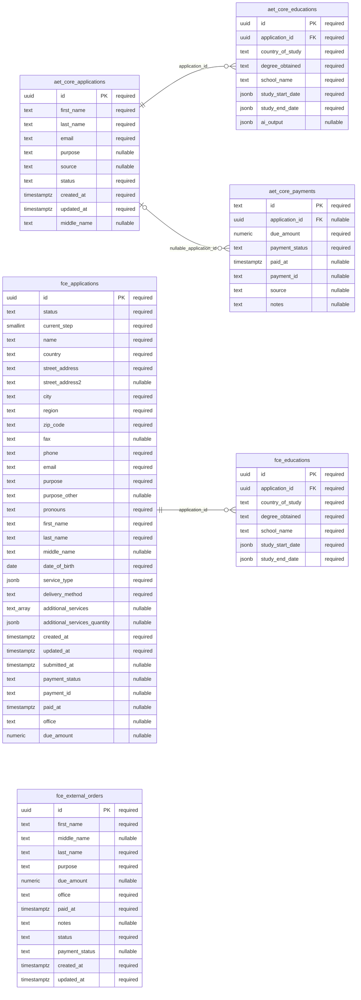
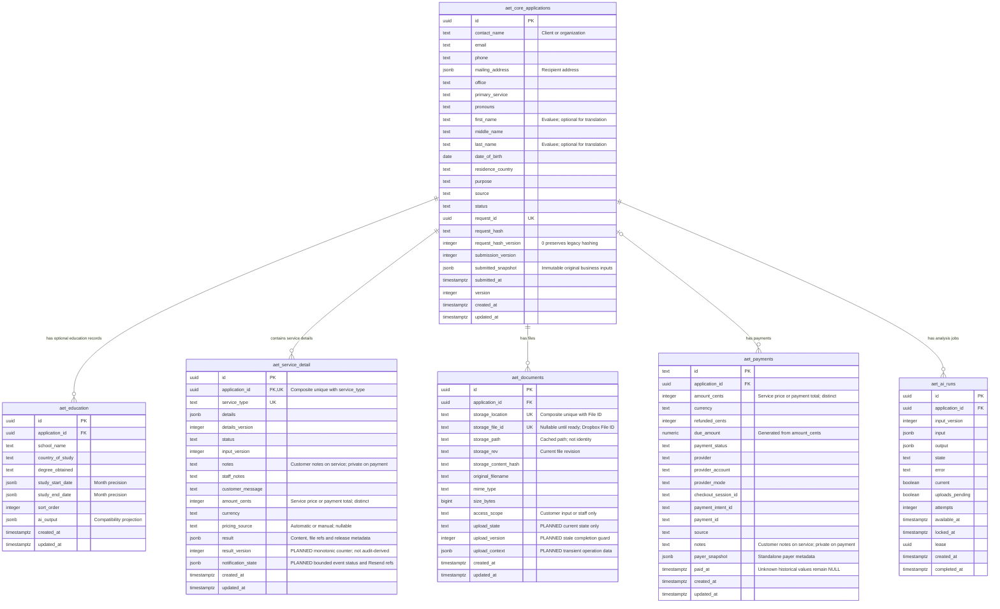

# Database architecture: legacy, current and proposed

Legacy/current inventory captured November 6, 2026 from read-only metadata and
`dev` at `90076a3`; no customer rows were read for that comparison. The target
view reflects the six-table design approved November 10, now verified for local
pre-evaluation only. On November 6, new dev Preview
pre-evaluation applications began using private `aet_preview_core`; see the
[hosted acceptance](archive/database-preview-acceptance-2026-11-06.md). Production
and old tables remain unchanged. The original legacy/current diagrams are the
pre-cutover inventory, not a claim that all runtime paths still use those tables.

Use the [visual viewer](diagrams/database-architecture.html) to switch between
the three diagrams and zoom. This file is the editable Mermaid source and field
crosswalk; the SVGs/viewer are generated companions, not separate specifications.

The [code-backed migration plan](database-migration-plan.md) records field and
supporting-record decisions, staged cutover and rollback gates. The target
diagram now shows all six planned entities. Five business tables
build on the additive migration; planned document/notification fields and the
retained AI execution entity are explicitly distinguished below. Existing
13-table rehearsal results are historical evidence. The subsequent
[six-table acceptance](archive/database-six-table-rehearsal-2026-11-10.md)
verifies isolated pre-evaluation; hosted/cross-service migration remains open.
See the [rehearsal guide](database-rehearsal.md).

## Reading order and scope

1. **Legacy:** two independent application families in `public`.
2. **Current:** separate pre-evaluation/evaluation workflow schemas plus legacy
   compatibility projections. CRM Live still uses the old public tables.
3. **Proposed:** six tables; one shared application identity, file/upload state,
   service notification state and one AI execution table. This revised target
   is implemented only for isolated pre-evaluation; hosted Preview retains its
   existing structure and other services still need convergence.

This comparison covers application, education, payment, file, AI, email, staff
and audit data. Payload content/version/media tables, Supabase-managed `auth.*`
internals and the separate report-editor branch are outside this diagram's scope.
They are not deleted or replaced by this proposal. Staff-account references to
Payload `public.users` and `auth.users` are recorded in the appendix.

`PK` = primary key; `FK` = an actual or explicitly proposed foreign key;
`UK` may be part of a composite unique constraint. Nullable fields are annotated
in the actual-schema diagrams. Lines labelled **NO FK** or **DRAFT** are logical
associations, not enforced database relationships. Only the legacy diagram shows
every column of every business table inline; current compatibility boxes are shortened, and the proposed view focuses on
six target tables. The expandable inventory below lists all
verified columns and key definitions, including tables omitted from the main views.

## 1. Legacy database

All six entities below are actual `public` tables. Formal evaluation stores its
payment summary directly on `fce_applications`; pre-evaluation/core applications
have a separate `aet_core_payments` table. `fce_external_orders` is independent:
it has no `application_id` and no foreign key to either application family.
File lists come from Dropbox folders; there is no shared `aet_documents` table.



## 2. Current dev database

| Diagram prefix | Actual schema / table |
| --- | --- |
| `pre_*` | `aet_preview_preeval.*` |
| `eval_*` | `aet_preview_evaluation.*` |
| `compat_core_*` | `aet_preview_legacy.aet_core_*` |
| `compat_fce_*` | `aet_preview_legacy.fce_*` |
| `document_locations` | `aet_preview_evaluation.document_locations` |

Local equivalents are `preeval`, `evaluation` and the local `public` fixture.
Cloud Preview remaps those logical names; it does not write these submissions
into the live `public` business tables. Five compatibility tables were observed;
there is no `aet_preview_legacy.fce_external_orders` in the metadata snapshot.

```mermaid
erDiagram
  direction LR
  pre_applications {
    uuid id PK "required"
    uuid request_id UK "required"
    text request_hash  "required"
    uuid legacy_id UK "nullable"
    text email  "required"
    text first_name  "required"
    text middle_name  "required"
    text last_name  "required"
    text country  "required"
    text locale  "required"
    text office  "nullable"
    text status  "required"
    text payment_status  "required"
    jsonb result  "nullable"
    integer result_version  "required"
    text result_source  "nullable"
    text ai_status  "required"
    text ai_error  "nullable"
    timestamptz ai_locked_at  "nullable"
    integer ai_attempts  "required"
    integer input_version  "required"
    text notes  "required"
    timestamptz created_at  "required"
    timestamptz updated_at  "required"
    text ai_pipeline  "required"
    boolean uploads_pending  "required"
    uuid ai_active_run  "nullable"
    timestamptz ai_available_at  "required"
  }
  pre_educations {
    uuid id PK "required"
    uuid application_id FK,UK "required"
    uuid legacy_id  "nullable"
    text school_name  "required"
    text country_of_study  "required"
    text degree_obtained  "required"
    text start_date  "required"
    text end_date  "required"
  }
  pre_files {
    uuid id PK "required"
    uuid application_id FK,UK "required"
    text name  "required"
    text mime_type  "required"
    integer bytes  "required"
    text sha256 UK "required"
    text dropbox_path UK "required"
    text state  "required"
    timestamptz created_at  "required"
  }
  pre_payments {
    uuid id PK "required"
    uuid application_id FK "required"
    text session_id UK "nullable"
    text payment_intent UK "nullable"
    integer amount_cents  "required"
    text currency  "required"
    text status  "required"
    integer refunded_cents  "required"
    timestamptz created_at  "required"
    timestamptz updated_at  "required"
  }
  eval_applications {
    uuid id PK "required"
    uuid request_id UK "required"
    text request_hash  "required"
    text access_hash  "required"
    text locale  "required"
    jsonb data  "required; intake snapshot"
    jsonb quote  "required"
    text status  "required"
    timestamptz created_at  "required"
    text payment_status  "required"
    integer version  "required"
    integer input_version  "required"
    jsonb confirmed_quote  "nullable"
    text customer_message  "required"
    text staff_notes  "required"
    uuid released_file_id  "nullable"
    timestamptz updated_at  "required"
  }
  eval_files {
    uuid id PK "required"
    uuid application_id FK,UK "required"
    text kind UK "required"
    text name  "required"
    text mime_type  "required"
    integer bytes  "required"
    text sha256 UK "required"
    text dropbox_path  "required"
    text state  "required"
    integer input_version UK "required"
    timestamptz created_at  "required"
  }
  eval_payments {
    uuid id PK "required"
    uuid application_id FK "required"
    text session_id UK "nullable"
    text payment_intent UK "nullable"
    integer amount_cents  "required"
    text status  "required"
    integer refunded_cents  "required"
    timestamptz created_at  "required"
    timestamptz updated_at  "required"
    timestamptz paid_at  "nullable"
  }
  document_locations {
    uuid application_id PK "required"
    text kind PK "required"
    jsonb storage  "required"
    timestamptz created_at  "required"
  }
  compat_core_applications {
    uuid id PK "required"
    text email  "required"
    text status  "required"
  }
  compat_core_educations {
    uuid id PK "required"
    uuid application_id FK "required"
    jsonb ai_output  "nullable"
  }
  compat_core_payments {
    text id PK "required"
    uuid application_id FK "nullable"
    numeric due_amount  "required"
    text payment_status  "required"
  }
  compat_fce_applications {
    uuid id PK "required"
    jsonb service_type  "required"
    text payment_status  "nullable"
    numeric due_amount  "nullable"
  }
  compat_fce_educations {
    uuid id PK "required"
    uuid application_id FK "required"
    text degree_obtained  "required"
    text school_name  "required"
  }
  pre_applications ||--o| pre_educations : "FK and UNIQUE application_id"
  pre_applications ||--o{ pre_files : application_id
  pre_applications ||--o{ pre_payments : application_id
  eval_applications ||--o{ eval_files : application_id
  eval_applications ||--o{ eval_payments : application_id
  compat_core_applications ||--o{ compat_core_educations : application_id
  compat_core_applications |o--o{ compat_core_payments : application_id
  compat_fce_applications ||--o{ compat_fce_educations : application_id
  pre_applications ||..o| compat_core_applications : "same-ID projection - NO FK"
  pre_educations ||..o| compat_core_educations : "same-ID projection - NO FK"
  pre_payments ||..o| compat_core_payments : "bridge projection - NO FK"
  eval_applications ||..o| compat_fce_applications : "same-ID projection - NO FK"
  pre_applications ||..o{ document_locations : "logical lookup - NO FK"
  eval_applications ||..o{ document_locations : "logical lookup - NO FK"
```



Important differences from the legacy view:

- Formal v2 submission saves `eval_applications.data.intake` as the authoritative
  submitted snapshot, plus a same-ID compatibility record for CRM. These are
  projections with limited workflow bridges, not unrestricted bidirectional sync.
- Formal education lives in the intake JSON and `compat_fce_educations`; there is
  no `aet_preview_evaluation.educations` table. Pre-evaluation's `pre_educations`
  has `UNIQUE(application_id)`, allowing at most one row, unlike the legacy 1:N model.
- `document_locations.storage` currently contains `write {office,path}`,
  `reads [{office,path}]`, and `archivePath`. It has no persisted Folder IDs.
  The registry has no application FK because it also resolves uncopied live records.
- Existing document APIs already return/use Dropbox File IDs, and AI manifests
  preserve provider IDs/revisions. What is missing is the proposed shared
  `aet_documents` index. Workflow `files.id` is an AET UUID; it is not Dropbox's ID.
  Some CRM/Status files are read directly from Dropbox and need not have a row in
  either workflow `files` table.
- `released_file_id`, `ai_active_run` and `legacy_id` have no FK in this snapshot.
  Payment-event tables deduplicate provider events by `id`; they have no payment FK.
  The existence of formal payment/report tables does not establish that v2 intake
  staff/payment/fulfillment is connected. See [current status](status.md).
- Email, AI-run, upload-attempt, session/token and audit tables are real supporting
  records, not extra customer applications. All fields are in the appendix.

### Formal intake JSON is not another table

The following are paths inside `eval_applications.data.intake`, from the current
form schema. Translation fields exist in the draft schema, but the persisted
intake endpoint currently accepts only `service = evaluation`.

```text
contactName, email, phone, service, office
pronouns, dateOfBirth, firstName, middleName, lastName, purpose, evaluationType
educations[]: school, country, degree, start, end
evaluationRequest.services.document: selected, tier, educationIndexes[]
evaluationRequest.services.course: selected, tier, educationIndexes[]
evaluationRequest.translation
evaluationDelivery: report, extraCopies, shipping
evaluationDelivery.address: name, country, street, street2, city, region, postal
sourceLanguage, targetLanguage, translationType, notes
```

`data` also retains the legacy-shaped `client`, `evaluee`, `educations`, `services`,
`delivery` and `notes`, plus `intakeVersion = 2`. `quote` is a separate JSON column
containing `currency`, `lines`, `min`, `max`, `needsQuote`; amounts are cents.
Compatibility `service_type.websiteQuote` also retains education IDs and selected
education IDs; these arrays are not foreign keys.

## 3. Proposed shared database model

**Six-table launch target approved November 10, 2026; isolated pre-evaluation verified.**
Five business tables plus AI runs remain. The Stripe webhook still processes
payments; locked payment state replaces the event ledger. No operation/actor history
or application request-frequency counter is retained. Current business state owns
notes, material requests, result versions and payment exemption. The full local
copy has 18 tables (6 shared + 12 formal); hosted Preview remains at 32. See
[acceptance](archive/database-six-table-rehearsal-2026-11-10.md).

The master has no storage, locale, access-token or session fields. Customers use
its random UUID in a non-expiring application URL, with no additional credential
or cookie; anyone holding the link can exercise that application's customer
operations. Staff identity/office checks and private-result visibility stay separate.
Documents keep File IDs, no Folder ID, folder row, `document_locations`, location
`kind`, `document_type` or `deleted_at`. Uploading files may temporarily lack a File ID.

**Language policy:** automatic business emails use English. The target application
has no `locale` or notification-language field; do not move that preference into
service JSON or another business table. Website language remains a URL/browser
preference. Translation source/target languages remain service requirements and
are unrelated to this policy. See the [email language decision](email-templates.md#planned-language-policy).

Known files can be looked up by File ID to obtain current metadata and paths.
Those paths may suggest directories to scan; staff must confirm an uncertain
directory before scanning or associating newly discovered files. Initial upload
paths are derived from office, Application ID and applicant name, not stored on
the master. See the [directory resolution rules](dropbox.md#directory-resolution-without-folder-ids).

The diagram shows **five business + one AI execution table**. `notification_state`
and `result_version` on service details and `upload_state`, `upload_version`,
`upload_context` on documents are additions verified in the isolated runtime.
The diagram's `PLANNED` labels mean not deployed to hosted Preview/Production;
these columns are present only in the compact-table rehearsal.
Operational fields reflect the retained convergence contracts; only relationships
labelled FK are proposed database constraints. Customer accounts remain deferred.



- Removed target tables: `aet_uploads` merges into documents; `aet_emails` is
  replaced by Resend history and bounded service notification state;
  `aet_sessions` and `aet_access_tokens` are replaced by application-ID URLs.
  `aet_payment_events` is also retired in isolation: Stripe retains event history,
  while atomic payment-state transitions protect against duplicate processing.
  Hosted tables remain unchanged; archive/reconciliation precede hosted retirement.
- `aet_ai_runs` preserves analysis/recovery state. `aet_audit` and `aet_rate_limits`
  are removed: no operation/actor history or request-frequency quotas in the target.
  No history arrays/counter fields replace them. Access checks, input/file limits
  and payment duplicate protection remain. Advanced tracking is deferred.
- `notification_state` stores current event status, stable dedupe identity,
  payload fingerprint and provider reference, not email bodies or a growing
  history list. Confirm provider history availability during implementation.
  Result version/material-request/exemption decisions already use service state.
  Old source evidence may be archived outside the runtime during migration.
- A document row represents a file and only its current upload operation. File ID
  may be null until ready; reject stale completion by upload version. Preserve
  the valid prior reference until a replacement succeeds, clear transient context
  afterward and do not store a permanent per-attempt history. No folder tracking
  or new upload table is introduced.
- `mailing_address` is one nullable JSONB field on the application master, with
  `name`, `country`, `street`, `street2`, `city`, `region` and `postal` keys. It is
  the recipient address for this application, shared by evaluation and translation;
  require a valid address only when physical delivery is requested. `pronouns`
  belongs to the evaluee, alongside their name, and may be absent for translation.
  See the [field definitions](migration-architecture.md#planned-application-contact-and-recipient-fields).
- A translation-only request has no education rows; evaluation may have multiple
  education rows. `aet_service_detail` permits multiple services per application,
  with composite uniqueness on `(application_id, service_type)` initially. A
  combined evaluation/translation request has two service rows under one ID.
  `details` has a defined validation schema per type; it is not arbitrary JSON.
  The service table replaces the earlier translation-only table proposal.
  Optional customer remarks belong in `aet_service_detail.notes`, not a duplicate
  `details.instructions` key. Keep each service's notes separate from internal
  staff notes and payment notes; retain historical submitted snapshots.
- Service pricing uses `amount_cents`, `currency` and `pricing_source`; no `quote`
  JSON or `aet_quotes` table is required. The server calculates fixed prices from
  the shared catalog, or staff enter the final amount. `null` means not priced;
  zero is an explicit known price. Save prices instead of recalculating history
  against a changed catalog. Sum service amounts in one currency and charge
  shared shipping once. Payments preserve the amount actually used at Checkout.
- Nullable `aet_service_detail.result` holds the current text/structured output,
  delivered document references and release status/time. File references point
  to `aet_documents.id` and pin the delivered revisions; File IDs and storage
  metadata stay on documents. No `aet_deliverables` table is needed. Preserve
  relevant input/result versions and existing release/payment/access checks.
  See the [delivery contract](database-migration-plan.md#service-delivery-result).
  The result is not an unlimited history list or permission to expose drafts.
- `storage_location` plus `storage_file_id` is a **composite** unique reference in
  documents; neither column alone is unique. File bytes stay in Dropbox.
- For a new application, derive the initial upload directory from office,
  Application ID and applicant name; save each successful upload's **File ID**.
  Do not persist Folder IDs or create folder records. Open/refresh resolves known
  File IDs and uses authorized, unambiguous current parent paths for scanning.
  Changed or conflicting directories, missing anchors and existing empty folders
  require staff confirmation. A moved file's parent is a candidate, not proof that
  all its contents belong to the application. Preview/download uses File ID after
  access checks; `storage_path` is cached file metadata, not an authoritative root.
  Staff may also look up a File ID directly; linking a new result requires an
  explicit application association and must not silently reassign another record.
- `aet_payments` preserves existing shared payment records/IDs and nullable links
  for standalone payments. The rename does not collapse provider ledgers into
  legacy summary columns: checkout sessions, payment intents, cents/currency,
  refunds and event deduplication remain in the workflow tables pending a separate
  payment-unification decision. Do not convert amounts or discard history silently.
  Add `created_at` for payment-record creation and `updated_at` for its last actual
  change; retain `paid_at` for successful payment. Refunds and duplicate webhook
  deliveries do not overwrite `paid_at`. See the [timestamp definitions](migration-architecture.md#planned-payment-timestamps).
- Keep full formal/pre-evaluation snapshots, quotes, AI input/result versions,
  report-release references and their dependent records. Linking these workflows
  to the shared master still requires a migration plan. Preserve `fce_*` readers
  and compatibility projections until cutover is separately verified.
- `document_locations` and its composite `(application_id, kind)` key describe
  the current implementation only. Before a separately authorized cutover, resolve
  legacy identities and historical write/read/archive references, register their
  files by File ID, and verify existing readers. Do not copy location `kind` or
  folder references into the target file table. Keep the actual registry and its
  callers intact until that migration is completed; this update changes no database.

See the [directory resolution decision](dropbox.md#directory-resolution-without-folder-ids)
and [full file synchronization design](dropbox.md#planned-shared-document-records).

## 4. Field-by-field crosswalk

Each legacy field appears below. **Current** points to its workflow representation
where one exists; compatibility copies still retain the legacy column. **Proposed**
describes an intended owner or an explicitly unresolved retention boundary, not
a migration already performed. `intake.*` means `eval_applications.data.intake.*`.

<details>
<summary>aet_core_applications: every legacy field</summary>

| Legacy field | Current representation | Proposed destination / disposition |
| --- | --- | --- |
| `id` | pre_applications.id | `aet_core_applications.id` |
| `first_name` | pre_applications.first_name | `aet_core_applications.first_name`; draft nullable for translation, still required by evaluation rules |
| `last_name` | pre_applications.last_name | `aet_core_applications.last_name`; draft nullable for translation, still required by evaluation rules |
| `email` | pre_applications.email | `aet_core_applications.email` |
| `purpose` | compat_core_applications.purpose (new submissions: degree-equivalency) | `aet_core_applications.purpose` |
| `source` | compat_core_applications.source (new submissions: null) | `aet_core_applications.source` |
| `status` | pre_applications.status (bridge maps needs_information to processing) | `aet_core_applications.status` |
| `created_at` | pre_applications.created_at / compatibility timestamp | `aet_core_applications.created_at` |
| `updated_at` | pre_applications.updated_at | `aet_core_applications.updated_at` |
| `middle_name` | pre_applications.middle_name | `aet_core_applications.middle_name` |

</details>

<details>
<summary>aet_core_educations: every legacy field</summary>

| Legacy field | Current representation | Proposed destination / disposition |
| --- | --- | --- |
| `id` | pre_educations.id / compat_fce_educations.id | `aet_education.id`; preserve identity and multiple degrees |
| `application_id` | pre_educations.application_id / compat_fce_educations.application_id | `aet_education.application_id`; preserve identity and multiple degrees |
| `country_of_study` | pre_educations.country_of_study / intake.educations[].country | `aet_education.country_of_study`; preserve identity and multiple degrees |
| `degree_obtained` | pre_educations.degree_obtained / intake.educations[].degree | `aet_education.degree_obtained`; preserve identity and multiple degrees |
| `school_name` | pre_educations.school_name / intake.educations[].school | `aet_education.school_name`; preserve identity and multiple degrees |
| `study_start_date` | pre_educations.start_date / intake.educations[].start; YYYY-MM → {year, month} | `aet_education.study_start_date`; preserve identity and multiple degrees |
| `study_end_date` | pre_educations.end_date / intake.educations[].end; YYYY-MM → {year, month} | `aet_education.study_end_date`; preserve identity and multiple degrees |
| `ai_output` | pre_applications.result → legacy JSON string; full history in pre.ai_runs | Retain read-only compatibility output; current output moves to the pre-evaluation service `result` after verified cutover, with AI history retained |

</details>

<details>
<summary>aet_core_payments: every legacy field</summary>

| Legacy field | Current representation | Proposed destination / disposition |
| --- | --- | --- |
| `id` | pre_payments.id UUID → compatibility text | Keep `aet_payments.id` compatibility; retain provider ledger separately |
| `application_id` | pre_payments.application_id | Keep `aet_payments.application_id` compatibility; retain provider ledger separately |
| `due_amount` | pre_payments.amount_cents / 100 | Keep `aet_payments.due_amount` compatibility; retain provider ledger separately |
| `payment_status` | pre_payments.status (creating/open → pending; partially_refunded → paid) | Keep `aet_payments.payment_status` compatibility; retain provider ledger separately |
| `paid_at` | compat_core_payments.paid_at (bridge uses payment updated_at on first paid state) | Keep `aet_payments.paid_at` compatibility; retain provider ledger separately |
| `payment_id` | pre_payments.payment_intent | Keep `aet_payments.payment_id` compatibility; retain provider ledger separately |
| `source` | compat_core_payments.source (website-local for bridge writes) | Keep `aet_payments.source` compatibility; retain provider ledger separately |
| `notes` | compat_core_payments.notes (refund projection; not full ledger) | Keep `aet_payments.notes` compatibility; retain provider ledger separately |

</details>

<details>
<summary>fce_applications: every legacy field</summary>

| Legacy field | Current representation | Proposed destination / disposition |
| --- | --- | --- |
| `id` | eval_applications.id | `aet_core_applications.id`; keep submitted snapshot; reconcile legacy meaning |
| `status` | eval_applications.status (legacy bridge maps status values) | `aet_core_applications.status`; keep submitted snapshot; reconcile legacy meaning |
| `current_step` | compat_fce_applications.current_step (3 on new submission) | Retain formal snapshot/workflow and legacy compatibility until detail migration is designed |
| `name` | intake.contactName | `aet_core_applications.contact_name`; keep submitted snapshot; reconcile legacy meaning |
| `country` | intake.evaluationDelivery.address.country | `aet_core_applications.mailing_address.country` for verified mailing values; preserve historical address meaning and compatibility until cutover |
| `street_address` | intake.evaluationDelivery.address.street | `aet_core_applications.mailing_address.street` for verified mailing values; preserve historical address meaning and compatibility until cutover |
| `street_address2` | intake.evaluationDelivery.address.street2 | `aet_core_applications.mailing_address.street2` for verified mailing values; preserve historical address meaning and compatibility until cutover |
| `city` | intake.evaluationDelivery.address.city | `aet_core_applications.mailing_address.city` for verified mailing values; preserve historical address meaning and compatibility until cutover |
| `region` | intake.evaluationDelivery.address.region | `aet_core_applications.mailing_address.region` for verified mailing values; preserve historical address meaning and compatibility until cutover |
| `zip_code` | intake.evaluationDelivery.address.postal | `aet_core_applications.mailing_address.postal` for verified mailing values; preserve historical address meaning and compatibility until cutover |
| `fax` | compat_fce_applications.fax; no v2 intake field | Retain formal snapshot/workflow and legacy compatibility until detail migration is designed |
| `phone` | intake.phone | `aet_core_applications.phone`; keep submitted snapshot; reconcile legacy meaning |
| `email` | intake.email | `aet_core_applications.email`; keep submitted snapshot; reconcile legacy meaning |
| `purpose` | intake.purpose (legacy code mapping) | `aet_core_applications.purpose`; keep submitted snapshot; reconcile legacy meaning |
| `purpose_other` | intake.notes | `aet_service_detail.notes` on the evaluation row for v2 intake; review historical purpose text and preserve the original snapshot |
| `pronouns` | intake.pronouns | `aet_core_applications.pronouns`; preserve evaluee meaning and existing values |
| `first_name` | intake.firstName | `aet_core_applications.first_name`; keep submitted snapshot; reconcile legacy meaning |
| `last_name` | intake.lastName | `aet_core_applications.last_name`; keep submitted snapshot; reconcile legacy meaning |
| `middle_name` | intake.middleName | `aet_core_applications.middle_name`; keep submitted snapshot; reconcile legacy meaning |
| `date_of_birth` | intake.dateOfBirth (optional in v2) | Retain formal snapshot/workflow and legacy compatibility until detail migration is designed |
| `service_type` | intake.evaluationRequest plus quote; legacy service keys and websiteQuote in compatibility JSON | Retain formal snapshot/workflow and legacy compatibility until detail migration is designed |
| `delivery_method` | intake.evaluationDelivery.shipping (legacy code mapping) | Retain formal snapshot/workflow and legacy compatibility until detail migration is designed |
| `additional_services` | intake.evaluationDelivery.report (legacy report-code mapping) | Retain formal snapshot/workflow and legacy compatibility until detail migration is designed |
| `additional_services_quantity` | intake.evaluationDelivery.extraCopies; compatibility JSON preserves counters | Retain formal snapshot/workflow and legacy compatibility until detail migration is designed |
| `created_at` | eval_applications.created_at / compatibility timestamp | `aet_core_applications.created_at`; keep submitted snapshot; reconcile legacy meaning |
| `updated_at` | eval_applications.updated_at | `aet_core_applications.updated_at`; keep submitted snapshot; reconcile legacy meaning |
| `submitted_at` | compat_fce_applications.submitted_at (no separate workflow column) | Retain formal snapshot/workflow and legacy compatibility until detail migration is designed |
| `payment_status` | eval_applications.payment_status (partially_refunded maps to paid in compatibility) | Retain formal provider payment/quote truth and legacy summary; no destructive merge |
| `payment_id` | eval_payments.payment_intent → compatibility summary | Retain formal provider payment/quote truth and legacy summary; no destructive merge |
| `paid_at` | eval_payments.paid_at; bridge preserves first compatibility paid_at using updated_at | Retain formal provider payment/quote truth and legacy summary; no destructive merge |
| `office` | intake.office (code) → compatibility office name | `aet_core_applications.office`; keep submitted snapshot; reconcile legacy meaning |
| `due_amount` | eval_applications.quote / confirmed_quote, or eval_payments.amount_cents; compatibility dollars | Retain formal provider payment/quote truth and legacy summary; no destructive merge |

</details>

<details>
<summary>fce_educations: every legacy field</summary>

| Legacy field | Current representation | Proposed destination / disposition |
| --- | --- | --- |
| `id` | pre_educations.id / compat_fce_educations.id | `aet_education.id`; preserve identity and multiple degrees |
| `application_id` | pre_educations.application_id / compat_fce_educations.application_id | `aet_education.application_id`; preserve identity and multiple degrees |
| `country_of_study` | pre_educations.country_of_study / intake.educations[].country | `aet_education.country_of_study`; preserve identity and multiple degrees |
| `degree_obtained` | pre_educations.degree_obtained / intake.educations[].degree | `aet_education.degree_obtained`; preserve identity and multiple degrees |
| `school_name` | pre_educations.school_name / intake.educations[].school | `aet_education.school_name`; preserve identity and multiple degrees |
| `study_start_date` | pre_educations.start_date / intake.educations[].start; YYYY-MM → {year, month} | `aet_education.study_start_date`; preserve identity and multiple degrees |
| `study_end_date` | pre_educations.end_date / intake.educations[].end; YYYY-MM → {year, month} | `aet_education.study_end_date`; preserve identity and multiple degrees |

</details>

<details>
<summary>fce_external_orders: every legacy field</summary>

| Legacy field | Current representation | Proposed destination / disposition |
| --- | --- | --- |
| `id` | Live `public.fce_external_orders.id`; no Preview compatibility table observed | Retain independent external order; application linkage is not designed |
| `first_name` | Live `public.fce_external_orders.first_name`; no Preview compatibility table observed | Retain independent external order; application linkage is not designed |
| `middle_name` | Live `public.fce_external_orders.middle_name`; no Preview compatibility table observed | Retain independent external order; application linkage is not designed |
| `last_name` | Live `public.fce_external_orders.last_name`; no Preview compatibility table observed | Retain independent external order; application linkage is not designed |
| `purpose` | Live `public.fce_external_orders.purpose`; no Preview compatibility table observed | Retain independent external order; application linkage is not designed |
| `due_amount` | Live `public.fce_external_orders.due_amount`; no Preview compatibility table observed | Retain independent external order; application linkage is not designed |
| `office` | Live `public.fce_external_orders.office`; no Preview compatibility table observed | Retain independent external order; application linkage is not designed |
| `paid_at` | Live `public.fce_external_orders.paid_at`; no Preview compatibility table observed | Retain independent external order; application linkage is not designed |
| `notes` | Live `public.fce_external_orders.notes`; no Preview compatibility table observed | Retain independent external order; application linkage is not designed |
| `status` | Live `public.fce_external_orders.status`; no Preview compatibility table observed | Retain independent external order; application linkage is not designed |
| `payment_status` | Live `public.fce_external_orders.payment_status`; no Preview compatibility table observed | Retain independent external order; application linkage is not designed |
| `created_at` | Live `public.fce_external_orders.created_at`; no Preview compatibility table observed | Retain independent external order; application linkage is not designed |
| `updated_at` | Live `public.fce_external_orders.updated_at`; no Preview compatibility table observed | Retain independent external order; application linkage is not designed |

</details>

### New shared fields and document identity

| Proposed field | Current source / correspondence | Change |
| --- | --- | --- |
| `aet_core_applications.contact_name` | `intake.contactName`; legacy `fce_applications.name` | Draft shared client field, separate from evaluee names |
| `aet_core_applications.phone` | `intake.phone`; legacy FCE phone | Draft shared field |
| `aet_core_applications.mailing_address` | `intake.evaluationDelivery.address` | One nullable JSONB recipient-address snapshot per application; shared by services and required for physical delivery |
| `mailing_address.name` | `intake.evaluationDelivery.address.name` | Recipient name; may differ from contact/evaluee; not a separate SQL column |
| `mailing_address.country` | `intake.evaluationDelivery.address.country` | Country code; validate against supported destinations |
| `mailing_address.street` | `intake.evaluationDelivery.address.street` | Primary street address |
| `mailing_address.street2` | `intake.evaluationDelivery.address.street2` | Optional apartment, suite or other address detail |
| `mailing_address.city` | `intake.evaluationDelivery.address.city` | City/locality |
| `mailing_address.region` | `intake.evaluationDelivery.address.region` | State/province; country-specific validation |
| `mailing_address.postal` | `intake.evaluationDelivery.address.postal` | Postal code; country-specific validation |
| `aet_core_applications.pronouns` | `intake.pronouns`; legacy `fce_applications.pronouns` | Evaluee title/pronoun selection; required in evaluation flows, nullable for translation and unknown legacy values |
| `aet_core_applications.office` | `intake.office` / `pre_applications.office`; legacy display labels | Draft normalize codes; do not change saved storage routing |
| `aet_core_applications.primary_service` | `intake.service`; dedicated route identifies pre-evaluation | Draft new discriminator; do not repurpose legacy `source` or forbid combinations |
| `aet_service_detail.id` | No shared service-detail table today | New AET UUID |
| `aet_service_detail.application_id` | Existing application identity | Required FK; unique only together with service type |
| `aet_service_detail.service_type` | `intake.service`, dedicated pre-evaluation route, evaluation translation add-on | One row per application/service type initially |
| `aet_service_detail.details` | Current service-specific intake fields and requirements | JSONB with an explicit server-validated schema per service type; preserve snapshots/workflow state |
| `aet_service_detail.notes` | `intake.notes`; v2 compatibility `fce_applications.purpose_other` | Optional customer notes for the corresponding service; plain text, initially up to 3000 characters; preserve snapshots and do not duplicate into every service row |
| `aet_service_detail.amount_cents` | Server-calculated fixed price, verified legacy final amount or authorized staff input | Nullable nonnegative integer cents; `null` is not priced, `0` is explicitly zero-priced; reconcile application-wide totals before splitting across services |
| `aet_service_detail.currency` | Shared price configuration or verified historical payment currency | `USD` initially; reject mixed-currency totals in one Checkout |
| `aet_service_detail.pricing_source` | Calculation path or authorized staff edit | `automatic` / `manual`; nullable for unpriced or unknown historical provenance; do not guess |
| `aet_service_detail.result` | `pre_applications.result` and result/input versions; formal `eval_applications.released_file_id` plus existing file/release records | Nullable JSONB for the current service output, document/revision references and release metadata; validate same-application IDs, preserve history and release guards; no deliverable table |
| `details.source_language` / `details.target_language` | General-form `sourceLanguage` / `targetLanguage` draft fields | Translation payload; not separate SQL columns |
| `details.translation_type` | General-form `translationType` draft field | Translation payload; align catalog values |
| `details.purpose` | Service-specific intended use | Optional translation payload; do not blindly copy evaluation purpose; free-text remarks use the separate `notes` column |
| `details.requested_deadline` | No current equivalent | Optional requested deadline; JSON format/time-zone semantics to define |
| `aet_service_detail.created_at` / `updated_at` | No current shared detail record | Service-detail record timestamps |
| `aet_documents.id` | Workflow `files.id` where present; none for some direct Dropbox discoveries | AET UUID, not Dropbox ID; reconcile existing IDs before reuse |
| `aet_documents.application_id` | Existing file row or authorized folder association | Explicit parent relation; no name-based reassignment |
| `aet_documents.storage_location` | Server account/namespace configuration, office routing | New stable connection key; CA/Boston labels do not provision accounts |
| `aet_documents.storage_file_id` | Dropbox listing/upload metadata `id`; existing API `FileEntry.id` and AI manifest IDs | Persist File ID for exact lookup and current metadata; never substitute workflow UUID or Folder ID |
| `aet_documents.storage_path` | Workflow `files.dropbox_path`, listing `path_display` | Cached current path, refreshed after moves |
| `aet_documents.original_filename` | Workflow `files.name` / first Dropbox discovery | Initial name; current display name comes from refreshed metadata |
| `aet_documents.mime_type` | Existing validation or file metadata | Allow unknown for externally discovered files |
| `aet_documents.size_bytes` | Workflow `files.bytes` / Dropbox `size` | Bytes, not file count |
| `aet_documents.created_at` | Existing index creation time or first discovery | Do not invent original upload time |
| `aet_payments.created_at` | Workflow `payments.created_at` where the record mapping is verified; absent from legacy shared payment table | Planned timestamp for payment-record creation; preserve trustworthy history and leave unknown legacy times distinguishable |
| `aet_payments.updated_at` | Workflow `payments.updated_at` where the record mapping is verified; absent from legacy shared payment table | Planned timestamp of the last actual payment-record change; not the payment-success time |

Current workflow `applications.locale` and existing token/session locale fields
are actual implementation details, not proposed application fields. No new business
locale field replaces them. Before a later authorized migration removes a stored
language dependency, update its email, receipt and link consumers and preserve
historical data/access compatibility. Current diagrams and the actual inventory
retain those columns; this planning update does not alter their schema or code.

The existing `document_locations.application_id` and `kind` are migration inputs
for resolving legacy application identities, not target file fields. Its `storage`
write/read/archive paths can help discover authorized historical files and capture
their File IDs; they do not become folder rows or a new location table. Registry
`created_at` must not be treated as a file upload timestamp. Preserve the current
registry until migration and historical-reader acceptance are separately complete.

`files.state`, `sha256`, `input_version`, file revisions/content hashes in AI
manifests, upload attempts, and released-file references are not discarded just
because the minimal document table omits them. Keep them in the workflow/processing
records and design their association before replacing an existing file table.
`document_type` and `deleted_at` are intentionally not proposed replacements.

## 5. Complete verified field inventory

This appendix lists every column for the selected schemas. Each constraint shown
is from the read-only database metadata, not inferred from matching field names.
Composite UK markers apply to the combination, not each marked column alone.
Check constraints, defaults and partial indexes are not exhaustively diagrammed.

<details>
<summary>aet_crm.audit — 9 fields</summary>

```text
id: uuid; required; PK
kind: text; required
record_id: text; required
actor: text; required
action: text; required
before_version: text; required
after_version: text; required
changes: jsonb; required
created_at: timestamptz; required
```

- `PRIMARY KEY (id)`

</details>

<details>
<summary>aet_preview_evaluation.access_tokens — 4 fields</summary>

```text
hash: text; required; PK
application_id: uuid; required; FK
expires_at: timestamptz; required
consumed_at: timestamptz; nullable
```

- `FOREIGN KEY (application_id) REFERENCES aet_preview_evaluation.applications(id) ON DELETE CASCADE`
- `PRIMARY KEY (hash)`

</details>

<details>
<summary>aet_preview_evaluation.applications — 17 fields</summary>

```text
id: uuid; required; PK
request_id: uuid; required; UK
request_hash: text; required
access_hash: text; required
locale: text; required
data: jsonb; required
quote: jsonb; required
status: text; required
created_at: timestamptz; required
payment_status: text; required
version: integer; required
input_version: integer; required
confirmed_quote: jsonb; nullable
customer_message: text; required
staff_notes: text; required
released_file_id: uuid; nullable
updated_at: timestamptz; required
```

- `PRIMARY KEY (id)`
- `UNIQUE (request_id)`

</details>

<details>
<summary>aet_preview_evaluation.audit — 6 fields</summary>

```text
id: bigint; required; PK
application_id: uuid; required; FK
actor: text; required
action: text; required
detail: jsonb; required
created_at: timestamptz; required
```

- `FOREIGN KEY (application_id) REFERENCES aet_preview_evaluation.applications(id) ON DELETE CASCADE`
- `PRIMARY KEY (id)`

</details>

<details>
<summary>aet_preview_evaluation.document_locations — 4 fields</summary>

```text
application_id: uuid; required; PK
kind: text; required; PK
storage: jsonb; required
created_at: timestamptz; required
```

- `PRIMARY KEY (application_id, kind)`

</details>

<details>
<summary>aet_preview_evaluation.emails — 18 fields</summary>

```text
id: uuid; required; PK
application_id: uuid; required; FK
kind: text; required
dedupe_key: text; required; UK
recipient: text; required
payment_id: uuid; nullable; FK
audit_id: bigint; nullable; FK
state: text; required
attempts: integer; required
provider_id: text; nullable
error: text; nullable
payload_hash: text; nullable
available_at: timestamptz; required
first_attempt_at: timestamptz; nullable
locked_at: timestamptz; nullable
lease: uuid; nullable
sent_at: timestamptz; nullable
created_at: timestamptz; required
```

- `FOREIGN KEY (application_id) REFERENCES aet_preview_evaluation.applications(id) ON DELETE CASCADE`
- `FOREIGN KEY (audit_id) REFERENCES aet_preview_evaluation.audit(id) ON DELETE CASCADE`
- `UNIQUE (dedupe_key)`
- `FOREIGN KEY (payment_id) REFERENCES aet_preview_evaluation.payments(id) ON DELETE CASCADE`
- `PRIMARY KEY (id)`

</details>

<details>
<summary>aet_preview_evaluation.files — 11 fields</summary>

```text
id: uuid; required; PK
application_id: uuid; required; FK,UK
kind: text; required; UK
name: text; required
mime_type: text; required
bytes: integer; required
sha256: text; required; UK
dropbox_path: text; required
state: text; required
input_version: integer; required; UK
created_at: timestamptz; required
```

- `FOREIGN KEY (application_id) REFERENCES aet_preview_evaluation.applications(id) ON DELETE CASCADE`
- `UNIQUE (application_id, kind, sha256, input_version)`
- `PRIMARY KEY (id)`

</details>

<details>
<summary>aet_preview_evaluation.intake_emails — 14 fields</summary>

```text
id: uuid; required; PK
application_id: uuid; required; FK,UK
recipient: text; required
state: text; required
attempts: integer; required
first_attempt_at: timestamptz; nullable
available_at: timestamptz; required
locked_at: timestamptz; nullable
lease: uuid; nullable
error: text; nullable
provider_id: text; nullable
sent_at: timestamptz; nullable
created_at: timestamptz; required
payload_hash: text; nullable
```

- `FOREIGN KEY (application_id) REFERENCES aet_preview_evaluation.applications(id) ON DELETE CASCADE`
- `UNIQUE (application_id)`
- `PRIMARY KEY (id)`

</details>

<details>
<summary>aet_preview_evaluation.payment_events — 3 fields</summary>

```text
id: text; required; PK
type: text; required
created_at: timestamptz; required
```

- `PRIMARY KEY (id)`

</details>

<details>
<summary>aet_preview_evaluation.payments — 10 fields</summary>

```text
id: uuid; required; PK
application_id: uuid; required; FK
session_id: text; nullable; UK
payment_intent: text; nullable; UK
amount_cents: integer; required
status: text; required
refunded_cents: integer; required
created_at: timestamptz; required
updated_at: timestamptz; required
paid_at: timestamptz; nullable
```

- `FOREIGN KEY (application_id) REFERENCES aet_preview_evaluation.applications(id) ON DELETE CASCADE`
- `UNIQUE (payment_intent)`
- `PRIMARY KEY (id)`
- `UNIQUE (session_id)`
- Additional index: `CREATE UNIQUE INDEX evaluation_one_open_payment ON aet_preview_evaluation.payments USING btree (application_id) WHERE (status = ANY (ARRAY['creating'::text, 'open'::text]))`

</details>

<details>
<summary>aet_preview_evaluation.sessions — 3 fields</summary>

```text
hash: text; required; PK
application_id: uuid; required; FK
expires_at: timestamptz; required
```

- `FOREIGN KEY (application_id) REFERENCES aet_preview_evaluation.applications(id) ON DELETE CASCADE`
- `PRIMARY KEY (hash)`

</details>

<details>
<summary>aet_preview_legacy.aet_core_applications — 10 fields</summary>

```text
id: uuid; required; PK
first_name: text; required
last_name: text; required
email: text; required
purpose: text; nullable
source: text; nullable
status: text; required
created_at: timestamptz; required
updated_at: timestamptz; required
middle_name: text; nullable
```

- `PRIMARY KEY (id)`

</details>

<details>
<summary>aet_preview_legacy.aet_core_educations — 8 fields</summary>

```text
id: uuid; required; PK
application_id: uuid; required; FK
country_of_study: text; required
degree_obtained: text; required
school_name: text; required
study_start_date: jsonb; required
study_end_date: jsonb; required
ai_output: jsonb; nullable
```

- `FOREIGN KEY (application_id) REFERENCES aet_preview_legacy.aet_core_applications(id) ON DELETE CASCADE`
- `PRIMARY KEY (id)`

</details>

<details>
<summary>aet_preview_legacy.aet_core_payments — 8 fields</summary>

```text
id: text; required; PK
application_id: uuid; nullable; FK
due_amount: numeric; required
payment_status: text; required
paid_at: timestamptz; nullable
payment_id: text; nullable
source: text; nullable
notes: text; nullable
```

- `FOREIGN KEY (application_id) REFERENCES aet_preview_legacy.aet_core_applications(id) ON DELETE CASCADE`
- `PRIMARY KEY (id)`

</details>

<details>
<summary>aet_preview_legacy.fce_applications — 32 fields</summary>

```text
id: uuid; required; PK
status: text; required
current_step: smallint; required
name: text; required
country: text; required
street_address: text; required
street_address2: text; nullable
city: text; required
region: text; required
zip_code: text; required
fax: text; nullable
phone: text; required
email: text; required
purpose: text; required
purpose_other: text; nullable
pronouns: text; required
first_name: text; required
last_name: text; required
middle_name: text; nullable
date_of_birth: date; nullable
service_type: jsonb; required
delivery_method: text; required
additional_services: text_array; nullable
additional_services_quantity: jsonb; nullable
created_at: timestamptz; required
updated_at: timestamptz; required
submitted_at: timestamptz; nullable
payment_status: text; nullable
payment_id: text; nullable
paid_at: timestamptz; nullable
office: text; nullable
due_amount: numeric; nullable
```

- `PRIMARY KEY (id)`

</details>

<details>
<summary>aet_preview_legacy.fce_educations — 7 fields</summary>

```text
id: uuid; required; PK
application_id: uuid; required; FK
country_of_study: text; required
degree_obtained: text; required
school_name: text; required
study_start_date: jsonb; required
study_end_date: jsonb; required
```

- `FOREIGN KEY (application_id) REFERENCES aet_preview_legacy.fce_applications(id) ON DELETE CASCADE`
- `PRIMARY KEY (id)`

</details>

<details>
<summary>aet_preview_preeval.ai_runs — 14 fields</summary>

```text
id: uuid; required; PK
application_id: uuid; required; FK
input_version: integer; required
input: jsonb; required
output: jsonb; nullable
state: text; required
error: text; nullable
created_at: timestamptz; required
completed_at: timestamptz; nullable
model: text; nullable
response_id: text; nullable
usage: jsonb; nullable
input_hash: text; nullable
prompt_version: text; nullable
```

- `FOREIGN KEY (application_id) REFERENCES aet_preview_preeval.applications(id)`
- `PRIMARY KEY (id)`

</details>

<details>
<summary>aet_preview_preeval.applications — 28 fields</summary>

```text
id: uuid; required; PK
request_id: uuid; required; UK
request_hash: text; required
legacy_id: uuid; nullable; UK
email: text; required
first_name: text; required
middle_name: text; required
last_name: text; required
country: text; required
locale: text; required
office: text; nullable
status: text; required
payment_status: text; required
result: jsonb; nullable
result_version: integer; required
result_source: text; nullable
ai_status: text; required
ai_error: text; nullable
ai_locked_at: timestamptz; nullable
ai_attempts: integer; required
input_version: integer; required
notes: text; required
created_at: timestamptz; required
updated_at: timestamptz; required
ai_pipeline: text; required
uploads_pending: boolean; required
ai_active_run: uuid; nullable
ai_available_at: timestamptz; required
```

- `UNIQUE (legacy_id)`
- `PRIMARY KEY (id)`
- `UNIQUE (request_id)`

</details>

<details>
<summary>aet_preview_preeval.audit — 6 fields</summary>

```text
id: bigint; required; PK
application_id: uuid; nullable; FK
actor: text; required
action: text; required
detail: jsonb; required
created_at: timestamptz; required
```

- `FOREIGN KEY (application_id) REFERENCES aet_preview_preeval.applications(id)`
- `PRIMARY KEY (id)`

</details>

<details>
<summary>aet_preview_preeval.document_uploads — 5 fields</summary>

```text
application_id: uuid; required; FK,PK
file_key: text; required; PK
attempt_id: uuid; required
state: text; required
updated_at: timestamptz; required
```

- `FOREIGN KEY (application_id) REFERENCES aet_preview_preeval.applications(id) ON DELETE CASCADE`
- `PRIMARY KEY (application_id, file_key)`

</details>

<details>
<summary>aet_preview_preeval.educations — 8 fields</summary>

```text
id: uuid; required; PK
application_id: uuid; required; FK,UK
legacy_id: uuid; nullable
school_name: text; required
country_of_study: text; required
degree_obtained: text; required
start_date: text; required
end_date: text; required
```

- `FOREIGN KEY (application_id) REFERENCES aet_preview_preeval.applications(id)`
- `UNIQUE (application_id)`
- `PRIMARY KEY (id)`

</details>

<details>
<summary>aet_preview_preeval.emails — 19 fields</summary>

```text
id: uuid; required; PK
application_id: uuid; nullable; FK
kind: text; required
dedupe_key: text; required; UK
recipient: text; required
state: text; required
provider_id: text; nullable
attempts: integer; required
error: text; nullable
available_at: timestamptz; required
locked_at: timestamptz; nullable
sent_at: timestamptz; nullable
created_at: timestamptz; required
result_version: integer; nullable
information_request_id: bigint; nullable; FK
access_token: text; nullable
payload_hash: text; nullable
first_attempt_at: timestamptz; nullable
lease: uuid; nullable
```

- `FOREIGN KEY (application_id) REFERENCES aet_preview_preeval.applications(id)`
- `UNIQUE (dedupe_key)`
- `FOREIGN KEY (information_request_id) REFERENCES aet_preview_preeval.audit(id)`
- `PRIMARY KEY (id)`

</details>

<details>
<summary>aet_preview_preeval.files — 9 fields</summary>

```text
id: uuid; required; PK
application_id: uuid; required; FK,UK
name: text; required
mime_type: text; required
bytes: integer; required
sha256: text; required; UK
dropbox_path: text; required; UK
state: text; required
created_at: timestamptz; required
```

- `FOREIGN KEY (application_id) REFERENCES aet_preview_preeval.applications(id)`
- `UNIQUE (application_id, sha256)`
- `UNIQUE (dropbox_path)`
- `PRIMARY KEY (id)`

</details>

<details>
<summary>aet_preview_preeval.payment_events — 3 fields</summary>

```text
id: text; required; PK
type: text; required
received_at: timestamptz; required
```

- `PRIMARY KEY (id)`

</details>

<details>
<summary>aet_preview_preeval.payments — 10 fields</summary>

```text
id: uuid; required; PK
application_id: uuid; required; FK
session_id: text; nullable; UK
payment_intent: text; nullable; UK
amount_cents: integer; required
currency: text; required
status: text; required
refunded_cents: integer; required
created_at: timestamptz; required
updated_at: timestamptz; required
```

- `FOREIGN KEY (application_id) REFERENCES aet_preview_preeval.applications(id)`
- `UNIQUE (payment_intent)`
- `PRIMARY KEY (id)`
- `UNIQUE (session_id)`
- Additional index: `CREATE UNIQUE INDEX preeval_one_open_checkout ON aet_preview_preeval.payments USING btree (application_id) WHERE (status = ANY (ARRAY['creating'::text, 'open'::text]))`

</details>

<details>
<summary>aet_preview_preeval.rate_limits — 3 fields</summary>

```text
key: text; required; PK
count: integer; required
expires_at: timestamptz; required
```

- `PRIMARY KEY (key)`

</details>

<details>
<summary>aet_preview_preeval.sessions — 6 fields</summary>

```text
hash: text; required; PK
application_id: uuid; nullable; FK
role: text; required
email: text; required
expires_at: timestamptz; required
created_at: timestamptz; required
```

- `FOREIGN KEY (application_id) REFERENCES aet_preview_preeval.applications(id)`
- `PRIMARY KEY (hash)`

</details>

<details>
<summary>aet_preview_preeval.tokens — 8 fields</summary>

```text
hash: text; required; PK
application_id: uuid; nullable; FK
role: text; required
email: text; required
locale: text; required
expires_at: timestamptz; required
consumed_at: timestamptz; nullable
created_at: timestamptz; required
```

- `FOREIGN KEY (application_id) REFERENCES aet_preview_preeval.applications(id)`
- `PRIMARY KEY (hash)`

</details>

<details>
<summary>aet_private.auth_attempts — 3 fields</summary>

```text
key: text; required; PK
attempts: integer; required
window_started_at: timestamptz; required
```

- `PRIMARY KEY (key)`

</details>

<details>
<summary>aet_private.password_recovery — 5 fields</summary>

```text
token_hash: text; required; PK
legacy_user_id: integer; nullable; FK
expires_at: timestamptz; required
consumed_at: timestamptz; nullable
staff_id: uuid; nullable; FK
```

- `FOREIGN KEY (legacy_user_id) REFERENCES aet_private.staff_accounts(legacy_user_id)`
- `PRIMARY KEY (token_hash)`
- `FOREIGN KEY (staff_id) REFERENCES aet_private.staff_accounts(migration_id)`

</details>

<details>
<summary>aet_private.staff_accounts — 11 fields</summary>

```text
legacy_user_id: integer; nullable; FK,UK
email: text; required; UK
auth_user_id: uuid; nullable; FK,UK
migration_id: uuid; required; UK,PK
migration_state: text; required
role: text; required
offices: text_array; required
include_unassigned: boolean; required
active: boolean; required
migrated_at: timestamptz; nullable
created_at: timestamptz; required
```

- `FOREIGN KEY (auth_user_id) REFERENCES auth.users(id)`
- `UNIQUE (auth_user_id)`
- `UNIQUE (email)`
- `FOREIGN KEY (legacy_user_id) REFERENCES users(id)`
- `UNIQUE (legacy_user_id)`
- `UNIQUE (migration_id)`
- `PRIMARY KEY (migration_id)`

</details>

<details>
<summary>public.aet_core_applications — 10 fields</summary>

```text
id: uuid; required; PK
first_name: text; required
last_name: text; required
email: text; required
purpose: text; nullable
source: text; nullable
status: text; required
created_at: timestamptz; required
updated_at: timestamptz; required
middle_name: text; nullable
```

- `PRIMARY KEY (id)`

</details>

<details>
<summary>public.aet_core_educations — 8 fields</summary>

```text
id: uuid; required; PK
application_id: uuid; required; FK
country_of_study: text; required
degree_obtained: text; required
school_name: text; required
study_start_date: jsonb; required
study_end_date: jsonb; required
ai_output: jsonb; nullable
```

- `FOREIGN KEY (application_id) REFERENCES aet_core_applications(id) ON DELETE CASCADE`
- `PRIMARY KEY (id)`

</details>

<details>
<summary>public.aet_core_payments — 8 fields</summary>

```text
id: text; required; PK
application_id: uuid; nullable; FK
due_amount: numeric; required
payment_status: text; required
paid_at: timestamptz; nullable
payment_id: text; nullable
source: text; nullable
notes: text; nullable
```

- `FOREIGN KEY (application_id) REFERENCES aet_core_applications(id) ON DELETE CASCADE`
- `PRIMARY KEY (id)`

</details>

<details>
<summary>public.fce_applications — 32 fields</summary>

```text
id: uuid; required; PK
status: text; required
current_step: smallint; required
name: text; required
country: text; required
street_address: text; required
street_address2: text; nullable
city: text; required
region: text; required
zip_code: text; required
fax: text; nullable
phone: text; required
email: text; required
purpose: text; required
purpose_other: text; nullable
pronouns: text; required
first_name: text; required
last_name: text; required
middle_name: text; nullable
date_of_birth: date; required
service_type: jsonb; required
delivery_method: text; required
additional_services: text_array; nullable
additional_services_quantity: jsonb; nullable
created_at: timestamptz; required
updated_at: timestamptz; required
submitted_at: timestamptz; nullable
payment_status: text; nullable
payment_id: text; nullable
paid_at: timestamptz; nullable
office: text; nullable
due_amount: numeric; nullable
```

- `PRIMARY KEY (id)`

</details>

<details>
<summary>public.fce_educations — 7 fields</summary>

```text
id: uuid; required; PK
application_id: uuid; required; FK
country_of_study: text; required
degree_obtained: text; required
school_name: text; required
study_start_date: jsonb; required
study_end_date: jsonb; required
```

- `FOREIGN KEY (application_id) REFERENCES fce_applications(id) ON DELETE CASCADE`
- `PRIMARY KEY (id)`

</details>

<details>
<summary>public.fce_external_orders — 13 fields</summary>

```text
id: uuid; required; PK
first_name: text; required
middle_name: text; nullable
last_name: text; required
purpose: text; required
due_amount: numeric; nullable
office: text; required
paid_at: timestamptz; required
notes: text; nullable
status: text; required
payment_status: text; nullable
created_at: timestamptz; required
updated_at: timestamptz; required
```

- `PRIMARY KEY (id)`

</details>

## 6. Decisions still needed before implementation

- Confirm the common master fields and the meaning of client versus evaluee;
  pure translation has no education rows and may have no evaluee.
- Plan same-ID master records for formal applications and reconcile existing
  pre-evaluation/legacy education IDs; never collapse multiple degrees into the
  current pre-evaluation table's unique application slot.
- Select authoritative mutable status and payment ownership. Preserve immutable
  submission/price snapshots and explain any lossy legacy projections.
- Reconcile legacy money in dollars with workflow cents, provider reference types,
  standalone payments and refunds. No implicit conversion or discarded history.
- Integrate shared documents with existing upload/AI/release metadata and saved
  folders before retiring any existing file records. Track File IDs and keep
  scanning on open; continuous background sync is outside this phase.

The task list remains in the [migration checklist](migration-checklist.md).
Customer accounts and email scheduling remain explicitly deferred there.
This comparison is not a migration script or a production readiness assertion.

## Sources and maintenance

- Read-only live `information_schema.columns`, `pg_constraint` and `pg_indexes`
  for the six public business tables and the five selected new-system schemas.
- [Schema routing](../lib/preeval/config.ts),
  [v2 intake persistence](../lib/application/intake-server.ts),
  [form fields](../lib/application/model.ts),
  [service choices](../lib/application/evaluation.ts),
  [delivery fields](../lib/application/delivery.ts).
- [Legacy writes](../lib/legacy-application/store.ts),
  [field mapping](../lib/legacy-application/mapping.ts),
  [workflow bridge source](../scripts/legacy/workflow-bridge.sql).
- [Saved locations](../lib/dropbox/storage.ts),
  [folder metadata](../lib/dropbox/paths.ts),
  [Dropbox API adapter](../lib/dropbox/server.ts),
  [AI document manifests](../lib/preeval/ai-documents.ts).
- [Approved planning boundaries](migration-architecture.md#planned-shared-application-model)
  and [shared document proposal](dropbox.md#planned-shared-document-records).

Keep the three Mermaid blocks here authoritative. Regenerate the matching SVGs
and visual viewer after editing diagrams; do not hand-edit their field lists.
Do not replace the two system/provider diagrams in migration-architecture.md.
