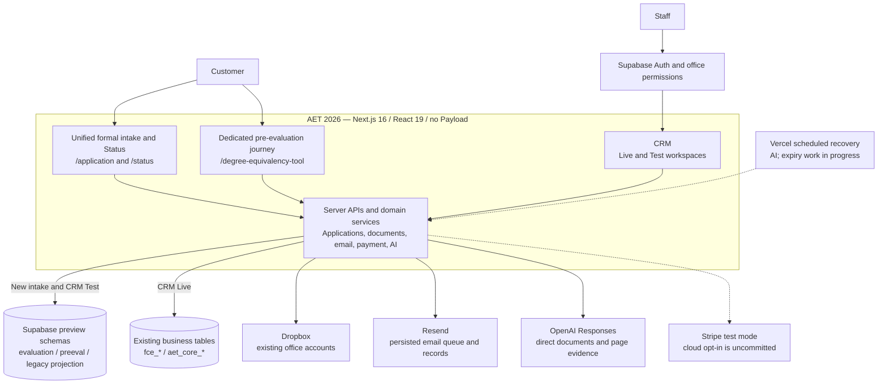
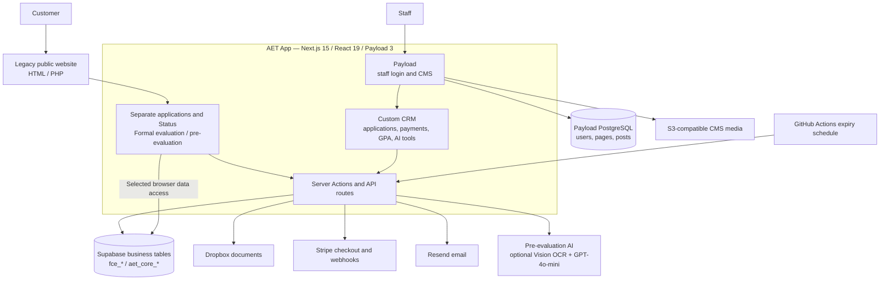

# Dev branch review and system architecture — 2026-10-22

## Historical snapshot and subsequent disposition

The findings, line numbers and diagrams below describe the reviewed baseline,
not the current unresolved backlog. Preserve them as review evidence. See
[migration architecture](migration-architecture.md) for the maintained architecture
reference and [migration checklist](migration-checklist.md) for current priorities.

| Finding | Subsequent local dev status |
| --- | --- |
| F1: Refund ordering | Fix committed in `d3506e0` |
| F2: Large-file upload | Fix committed in `2e66f3f` |
| F3: Supplemental documents | Fix committed in `7f82f7e` |
| F4: Stale upload completion | Fix committed in `1acb316` |
| F5: Independent email recovery | Code committed in `91df7fa`; further design, implementation and scheduler activation deferred by the owner on October 22 |

The owner will reconsider F5 only if operational checks show a substantial
unsent-email backlog or recurring failures. No email monitoring or scheduler is
activated by this documentation update. Committed fixes do not establish hosted
acceptance; local Stripe test-payment evidence is recorded separately in
[the pre-evaluation guide](pre-evaluation-local.md#october-22-stripe-test-payment-acceptance).
The recommended sequence at the end remains part of the original review, subject
to this later owner decision.

## Scope and conclusion

The new system has substantial working infrastructure, but it is still a staged
migration rather than a complete replacement for AET App. The strongest next
milestone is a reliable pre-evaluation journey, including failure recovery and
real Stripe test-mode checkout/webhook acceptance, before extending the unified
intake into the full formal-evaluation workflow.

- Reviewed repository: `aet-website-2026-dev`, branch `dev`.
- Committed baseline: `1d431ac69d60fd44398d3cdbbf63982d710493bc`.
- Compared with local `main` at `71ddcf935a3a92f872d49147236f044995c11bf2`;
  merge base `902657b8d3b40c7e971de81dbe9dd8997d0a9ede`.
- The comparison contains 44 dev-only commits and one main-only commit,
  affecting 298 files, with 28,761 insertions and 222 deletions.
- Legacy reference: `aet-app` at `f72f73f` and the static/PHP public website in
  `server-54.213.58.23/americantranslationservice.com`.
- Coverage focused on application intake, CRM authorization and data sources,
  customer status, documents, AI, email delivery and payment transitions. This is
  not a claim of exhaustive line-by-line verification of every changed file.
- Concurrent uncommitted work includes payment-expiry automation, Status deadline
  behavior, pre-evaluation cloud Stripe test opt-in, tests and environment docs.
  These were inspected separately and preserved. All five findings below also
  exist in the committed baseline; they are not attributed to the concurrent work.
- No fetch, production-state verification, deployment, database mutation, real
  payment, email delivery or paid model call was performed during this review.

## Findings

### F1 — P1: Preserve refunds that arrive before checkout completion

**Location:** `lib/preeval/payments.ts`, refund lookup and early return, currently
lines 174–177. The same defect exists in `lib/evaluation-application/payments.ts`,
lines 79–80. Line numbers reflect the reviewed working tree and may move.

The refund handler resolves a payment solely through `payment_intent`, which is
only stored when checkout completion/reconciliation is processed. If
`charge.refunded` arrives first, the handler returns without recording the event;
the webhook nevertheless succeeds. A later paid checkout event then marks the
application paid and can publish a pre-evaluation result. Checkout reconciliation
does not retrieve refund state, so it does not repair this ordering.

[Stripe explicitly does not guarantee webhook event ordering](https://docs.stripe.com/webhooks#event-ordering).
An offline reproduction of the committed functions produced a paid/completed
application and retained only the checkout event after refund-then-checkout input.
The reproduction mocks SQL/provider boundaries; it is not a live Stripe test.

**Fix:** Persist unmatched events for reconciliation, or resolve the associated
payment before acknowledging successful handling. Refund state must take
precedence when later checkout events arrive. Add both event-order permutations
to regression tests. This is a release blocker before enabling live payments;
current new-business payment code is test-mode restricted.

### F2 — P1: Use chunked uploads for the advertised 20 MB pre-evaluation files

**Location:** `components/preeval/customer.tsx`, lines 165–168 and the later
customer upload handler near line 461; `app/api/pre-evaluation/[...path]/route.ts`,
the `files` POST branch; `lib/preeval/domain.ts`, `MAX_FILE_BYTES`.

The UI accepts files up to 20 MiB but sends each file in one multipart request to
a Next API route. [Vercel Functions limit request bodies to 4.5 MB](https://vercel.com/docs/functions/limitations#request-body-size).
A valid 6 MB PDF therefore cannot reach the application upload handler on that
deployment. Both initial and subsequent uploads use this path. The application
has already been created with uploads pending, leaving analysis blocked.

The shared Dropbox uploader already supports approximately 3 MiB chunks, but this
pre-evaluation customer flow does not use it. This finding follows the actual
client/server request path and the platform limit; no oversized hosted request
was sent during this review.

**Fix:** Route both customer upload entry points through the shared chunked
uploader, preserving upload-batch completion and AI scheduling. Verify an allowed
file above 4.5 MB on the intended hosted environment, including interrupted retry.

### F3 — P1: Allow customers to fulfill a request for additional information

**Location:** `lib/preeval/ai-jobs.ts`, lines 8–16 and 25–28.

The staff information-request action changes an application to `needs_information`
and emails the customer a link to review the request and upload documents. The
customer page still offers upload, but `pauseForUpload` and `completeUploads`
explicitly reject this status. Staff AI retry also excludes it. The advertised
supplement-and-resume journey therefore returns 409 instead of progressing.

The offline reproduction confirmed rejection at upload start and completion.
There is no normal explicit resume action in the reviewed workflow that resolves
the customer's supplemental upload path.

**Fix:** Define a deliberate transition from requested information to uploading
and then queued/reviewing after completion. Continue blocking cancelled cases.
Test the complete staff request → customer upload → completion → re-analysis flow.

### F4 — P2: Validate the current upload attempt before resetting a result

**Location:** `lib/preeval/ai-jobs.ts`, lines 49–58.

`finishDocumentUpload` resets the application/AI result and inserts a file before
updating the document-upload row by attempt ID. It never checks whether that
attempt is still current. `startDocumentUpload` permits replacing a stalled
attempt after 15 minutes, while the shared upload capability lasts longer.

An older request can consequently complete after a replacement upload and a new
AI result or staff correction. Its final attempt-ID update affects zero rows,
but the preceding reset and file insertion still commit. This can clear a newer
result and return the case to pending uploads. The offline SQL-boundary
reproduction confirmed those writes occur before the unmatched-attempt update.

**Fix:** Atomically claim/validate the current attempt and expected state before
any application/file mutation. A stale completion must be a no-op. Apply the same
fencing to storage finalization where possible. Test late success after retry and
after a newer result has been published.

### F5 — P2: Recover pending email independently of AI-job eligibility

**Location:** `lib/preeval/ai-scheduler.ts`, lines 29–35;
`lib/preeval/ai-jobs.ts`, lines 63–70; `lib/preeval/email.ts`, queue selection.

Cloud recovery first selects due queued/stale-running AI jobs, then dispatches
email only for those applications. If AI completes but its result email fails,
the application no longer qualifies for AI recovery. Mail is eligible for retry
after 60 seconds, but no independent cloud outbox scheduler picks it up.

Authorized customer reads can retry delivery while a customer continues using the
page. Closing the page removes that incidental recovery path. The local worker
is not supported in cloud-preview mode, and the 23-hour delivery window later
prevents ordinary retries. An offline scheduler reproduction with no due AI jobs
and pending mail made zero delivery calls.

**Fix:** Add independently scheduled, bounded outbox recovery with the existing
recipient/scope safeguards. Define a review/reconciliation path beyond the
provider idempotency window. Do not rerun AI merely to retry a notification.

## New system architecture

Solid arrows represent implemented code paths, not a claim that every path is
production enabled. Dashed arrows denote gated testing or work in progress.

Key boundaries that the diagram deliberately keeps visible:

- The unified form has real persistence for formal evaluation (`intakeVersion:2`),
  a server-priced quote snapshot, legacy-compatible projections, confirmation
  email, Status and documents. Its CRM management is read-only and its payment
  processing is disabled. Its pre-evaluation and translation branches are not yet
  equivalent persisted end-to-end journeys.
- The working pre-evaluation implementation is a separate journey. It has its own
  application, education, file, payment, email, AI-run and audit tables. It submits
  original documents to OpenAI and resolves evidence to server-controlled pages.
- An earlier formal-evaluation pilot has payment, staff workflow and report-release
  code. It does not automatically support v2 intake; old workflow guards reject
  that version. These paths still need deliberate integration.
- Preview schemas are `aet_preview_evaluation`, `aet_preview_preeval` and
  `aet_preview_legacy`. They are logical isolation within the configured existing
  Supabase project, not proof of an independent production database.
- CRM Live accesses existing business tables through a restricted database role.
  Staff identity uses Supabase Auth plus database-held office permissions.
  Consequently, replacing the CRM UI does not retire the legacy business data.
- Dropbox still uses existing office accounts. Preview database isolation does not
  imply every external provider has been isolated into a separate test account.
- The committed baseline restricts the new payment pilot to local test mode.
  Concurrent work adds an opt-in cloud pre-evaluation test path. It is uncommitted
  and no real checkout/webhook acceptance was run in this review. The website's
  standalone `/payment` flow is separate from v2 intake.
- AI dispatch uses request-triggered `after()` plus bounded scheduled recovery,
  not a separate always-running queue service. Expiry automation is additional
  opt-in work in progress; deployment activation was not checked here.

## Legacy system architecture

The two database nodes describe logical access responsibilities; this review did
not verify whether their configured connections resolve to separate physical
databases. The scheduler is present in source; current activation is unverified.

Payload supplies staff login and content management; the business CRM is custom
React code using Supabase data rather than a set of ordinary Payload business
collections. The legacy app also contains a Brave Search helper. The new system
removes Payload, moves staff identity to Supabase Auth, adds server-enforced office
permissions and separates business modules, while retaining compatibility with
legacy records and office storage.

Versions come from package/lock files, not from an online deployment fingerprint:
new Next 16.3.6; legacy Next 15.2.6, React 19.0.1 and Payload 3.12.0.

## Verification and limitations

| Check performed in this review | Result |
| --- | --- |
| Full installed Vitest suite on the observed working tree | 41 files, 515 tests passed |
| TypeScript without emitting or incremental writes | Passed |
| Four targeted offline reproductions against committed `1d431ac` functions | F1, F3, F4 and F5 reproduced |
| F2 upload path and platform documentation | Mismatch confirmed by source tracing; no hosted large-file test |
| Live database policies, permissions and production data | Not inspected or mutated during this review |
| Real Stripe, email, Dropbox or AI acceptance | Not performed during this review |
| Production build | Not run, as required by repository instructions |
| Frontend/browser acceptance | Not repeated; no frontend implementation was changed |

The working tree changed concurrently: an earlier suite run passed 498 tests;
the last complete run passed 515. Passing the suite does not cover the failure
sequences above. Earlier live acceptance claims in `docs/status.md` remain prior
evidence and are not represented as checks performed by this review.

Offline evidence was saved locally to
`/private/tmp/aet-review-20261022/reproduce.cjs` and
`/private/tmp/aet-review-20261022/reproduction-results.json`. These are temporary
review artifacts, not production tests or a substitute for database integration.

## Recommended sequence

1. Fix F1–F3, then F4–F5; retain each failure sequence as a regression test.
2. Complete pre-evaluation hosted acceptance using Stripe test checkout and real
   webhook delivery, including refund-before-checkout, a file larger than 4.5 MB,
   request-information/resubmission, stale upload completion and mail recovery
   after the customer closes the page.
3. Decide how v2 formal intake enters staff quoting, payment, report production
   and release. Integrate it with one authoritative workflow rather than allowing
   the older pilot and v2 intake to diverge further.
4. Add translation to the unified intake after that shared workflow is stable.
   Retire AET App only after data access, files, notifications, payments and old
   entry URLs have an accepted replacement and rollback plan.

## Architecture source index

New system, paths relative to `aet-website-2026-dev`:

- `package.json`; `lib/application/intake-server.ts`; `lib/application/intake-email.ts`
- `lib/customer-status/model.ts`; `components/crm/intake-drawer.tsx`
- `lib/preeval/config.ts`; `lib/preeval/db.ts`; `lib/preeval/service.ts`
- `lib/preeval/openai.ts`; `lib/preeval/ai-pages.ts`; `lib/preeval/ai-scheduler.ts`
- `lib/preeval/email.ts`; `lib/preeval/payments.ts`
- `lib/evaluation-application/service.ts`; `lib/evaluation-application/payments.ts`
- `lib/staff/session.ts`; `lib/staff/config.ts`; `lib/crm/live-server.ts`
- `lib/dropbox/server.ts`; `lib/dropbox/application.ts`; `lib/dropbox/storage.ts`
- `vercel.json`; `lib/customer-status/expiry.ts` (uncommitted)

Legacy system, paths relative to `aet-app`:

- `package.json`; `package-lock.json`; `src/payload.config.ts`
- `src/app/(payload)/admin/CRM/page.tsx`
- `src/app/(frontend)/(aet-app)/utils/actions.tsx`
- `src/app/(frontend)/(aet-app)/utils/supabase/client.ts` and `server.ts`
- `src/app/(frontend)/(aet-app)/utils/email/actions.tsx`
- `src/app/(frontend)/(aet-app)/api/dropbox/`
- `src/app/(frontend)/(aet-app)/api/stripe/`
- `src/app/(frontend)/(aet-app)/api/ocr/route.ts`
- `src/app/(frontend)/(aet-app)/api/degree-equivalency/route.ts`
- `.github/workflows/check-expired-applications.yml`

Legacy public-site links: `americantranslationservice.com/chinese.html` and
`americantranslationservice.com/e_notarized.html` in `server-54.213.58.23`.
