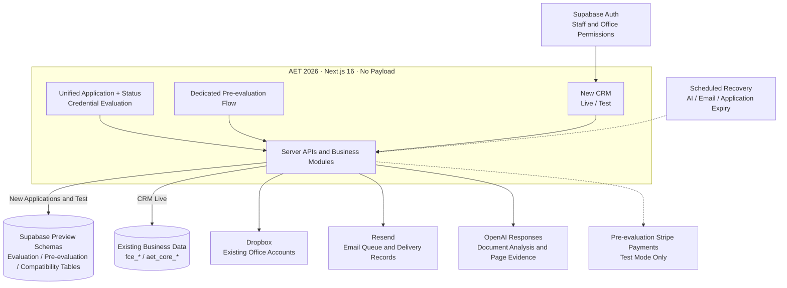
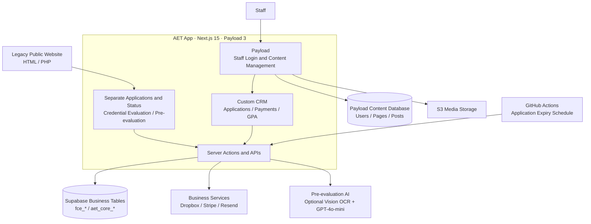

# AET App to AET 2026: Migration Architecture

This document is the architecture reference for the migration from the legacy
public website and AET App to AET 2026. Keep the two diagrams here; the README
and migration checklist link to this page.

The diagrams originate from the October 22, 2026 review of `dev` at `1d431ac`
and the accompanying working tree. They describe component relationships, not
a production deployment certification. Subsequent implementation and acceptance
are summarized in the [migration checklist](migration-checklist.md) and
[implementation status](status.md). Detailed findings and verification evidence
are preserved in the [dated archives](README.md#historical-evidence).

## AET 2026 architecture

Solid arrows show implemented connections. Dashed arrows indicate gated test
integrations or scheduled capabilities that require environment-specific activation.

### Migration boundaries

- **Unified intake:** formal evaluation can save the v2 intake, display Status
  and manage documents. Payment, staff processing and report release still need
  integration with that intake. Pre-evaluation and translation choices in the
  general form do not imply complete persisted journeys.
- **Pre-evaluation:** the dedicated flow has its own application, document,
  payment, AI and notification lifecycle. See the [pre-evaluation guide](pre-evaluation-local.md)
  for configuration and dated acceptance evidence. Test-mode integration does not
  enable formal-intake payments or production charges.
- **Shared business data:** CRM Live reads and edits existing `fce_*` and
  `aet_core_*` records. CRM Test and new intake use preview schemas; changing the
  UI does not migrate all records into a new database.
- **External services:** Dropbox continues using existing office accounts.
  Preview database isolation does not imply separate storage or provider accounts.
- **Background recovery:** AI recovery, independent email recovery and payment
  expiry have separate responsibilities. Further email-recovery work and scheduler
  activation are deferred by the owner; payment expiry has its own recorded
  activation. Track each job in the checklist rather than inferring its status
  from this diagram.
- **Other paths:** the earlier formal-evaluation pilot and the standalone website
  payment page are not automatically connected to the unified v2 intake. They
  are omitted from this overview to keep the main migration boundaries readable.

## Legacy architecture

The diagram describes the legacy source implementation. The two database nodes
represent logical responsibilities, not a verified separation into different
physical databases. The expiry schedule exists in source; the arrow does not
establish that the scheduler is currently active.

Payload supplies staff login and content management. The business CRM is custom
React code backed by Supabase rather than ordinary Payload business collections.
Some legacy components also access Supabase through its browser client; the
diagram groups the main business access paths for readability.

## Maintaining this reference

- Update the relevant diagram when component ownership, data sources or provider
  connections change. Keep every diagram label in English.
- Keep current tasks in the checklist and verified capability in status; link
  detailed dated evidence from the archives. Do not treat an architecture
  connection as a passed acceptance test.
- Preserve the dated review as a historical snapshot. Use this document for the
  maintained overview rather than duplicating Mermaid blocks in the README.
- Before retiring AET App, verify replacement coverage for customer URLs, staff
  access, historical data, documents, payment callbacks and notification recovery.
  Follow [app URL compatibility](app-url-compatibility.md) and the migration
  checklist for the remaining cutover requirements.
