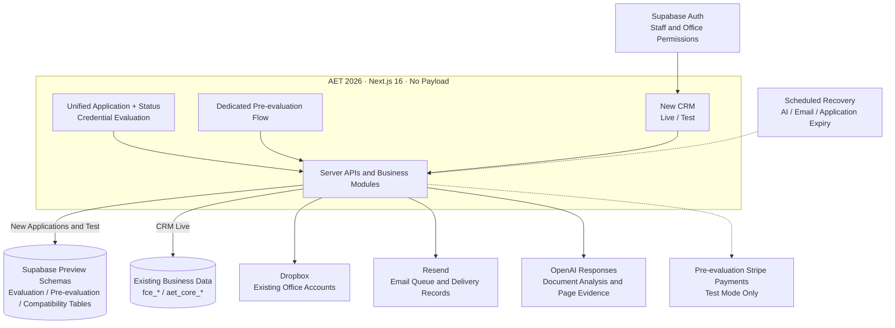
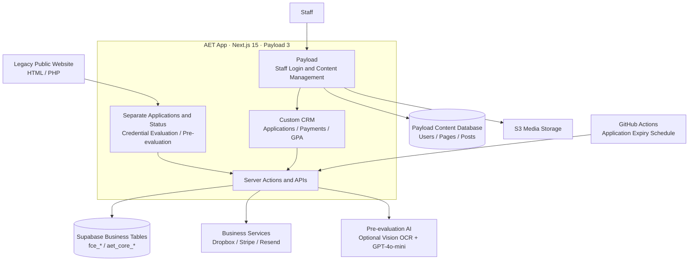

# AET App to AET 2026: Migration Architecture

This document is the architecture reference for the migration from the legacy
public website and AET App to AET 2026. Keep the two diagrams here; the README
and migration checklist link to this page. Proposed data-model changes are kept
in a separate, explicitly unimplemented section below.

The diagrams originate from the October 22, 2026 review of `dev` at `1d431ac`
and the accompanying working tree. They describe component relationships, not
a production deployment certification. Subsequent implementation and acceptance
are summarized in the [migration checklist](migration-checklist.md) and
[implementation status](status.md). Detailed findings and verification evidence
are preserved in the [dated archives](README.md#historical-evidence).

For database tables and individual fields, use the separate
[legacy/current/proposed database comparison](database-architecture.md).
Its proposed view is a discussion model, not an implemented extension of the
system diagrams below.

## AET 2026 architecture

Solid arrows show implemented connections. Dashed arrows indicate gated test
integrations or scheduled capabilities that require environment-specific activation.

### Migration boundaries

- **Unified intake:** formal evaluation can save the v2 intake, display Status
  and manage documents. Payment, staff processing and report release still need
  integration with that intake. Pre-evaluation and translation choices in the
  general form do not imply complete persisted journeys.
- **Pre-evaluation:** the dedicated flow has its own application, document,
  payment, AI and notification lifecycle. See the [pre-evaluation guide](pre-evaluation-local.md)
  for configuration and dated acceptance evidence. Test-mode integration does not
  enable formal-intake payments or production charges.
- **Shared business data:** CRM Live reads and edits existing `fce_*` and
  `aet_core_*` records. CRM Test and new intake use preview schemas; changing the
  UI does not migrate all records into a new database.
- **External services:** Dropbox continues using existing office accounts.
  Preview database isolation does not imply separate storage or provider accounts.
- **Background recovery:** AI recovery, independent email recovery and payment
  expiry have separate responsibilities. Further email-recovery work and scheduler
  activation are deferred by the owner; payment expiry has its own recorded
  activation. Track each job in the checklist rather than inferring its status
  from this diagram.
- **Other paths:** the earlier formal-evaluation pilot and the standalone website
  payment page are not automatically connected to the unified v2 intake. They
  are omitted from this overview to keep the main migration boundaries readable.

## Legacy architecture

The diagram describes the legacy source implementation. The two database nodes
represent logical responsibilities, not a verified separation into different
physical databases. The expiry schedule exists in source; the arrow does not
establish that the scheduler is currently active.

Payload supplies staff login and content management. The business CRM is custom
React code backed by Supabase rather than ordinary Payload business collections.
Some legacy components also access Supabase through its browser client; the
diagram groups the main business access paths for readability.

## Planned shared application model

**Planning decision — November 6, 2026; not implemented.** The owner approved
documenting shared service details and documents, with no database changes now.
The current plan uses `aet_service_detail` and `aet_documents`.
These proposed tables are not connections implemented in the diagrams above.
Implementation remains TODO in the [checklist](migration-checklist.md#unified-application-and-fulfillment).

Evolve the existing application master rather than introduce another independent
application identity. The intended parent is `aet_core_applications`; preserve
Application IDs and existing education/payment relationships. Before implementing,
resolve how current `fce_*` records and separate intake/workflow schemas map to
that parent. This proposal does not claim they already share one physical table
or authorize a rewrite, backfill or cutover.

| Record | Intended relationship and responsibility |
| --- | --- |
| Application master | Shared client/organization, contact, evaluee pronouns/name, application mailing address, office and state; no storage configuration or persisted UI locale |
| `aet_education` | Planned name for the shared education table; preserve existing education rows/IDs and 1:N application relationships; pure translation creates no placeholder row |
| `aet_service_detail` | Zero or more service detail rows with optional customer notes; initially at most one row per application/service type |
| `aet_documents` | Zero or more shared file records per application; details in the [Dropbox design](dropbox.md#planned-shared-document-records) |
| `aet_payments` | Preserve existing records/application links; add `created_at` and `updated_at`, retain `paid_at`; do not duplicate payment state in service details |

Evaluation still requires education where its service rules require it. A combined
evaluation-and-translation request may have both education rows and translation
details under one Application ID. The primary service selects the form flow; it
must not prohibit additional service details or require duplicate file uploads.

The owner-selected target names are `aet_education` (singular) and `aet_payments`.
The actual legacy/current names remain `aet_core_educations` and
`aet_core_payments`; no rename or payment-ledger consolidation has been applied.

**Email language decision — November 6, 2026:** all automatic business emails
use English. Omit `locale` from the target application and do not replace it with
a notification-language preference elsewhere. Page language is selected through
the URL/browser; translation source and target languages remain service inputs.
See the [email language policy](email-templates.md#planned-language-policy).
Existing locale columns and runtime behavior are unchanged until their consumers
are updated in a separately implemented migration.

The application master has no storage fields. The target uses
`aet_documents` for files only: each row stores its application link, storage
connection and Dropbox File ID, with a cached last-observed file path. There is
no Folder ID, folder row, location `kind` or `document_locations` in the target.
Service types belong to `aet_service_detail`, not the file-location identity.

Known files can be found directly by File ID. Their current paths can suggest
directories for scan-on-open synchronization; uncertain, changed or conflicting
directories require staff confirmation before scanning/importing new files.
This includes an existing empty folder or a lack of accessible file anchors.
For a new application's first upload, derive the path from office, Application ID
and applicant name, then register each uploaded file. No folder mapping is stored.
See the [directory resolution rules](dropbox.md#directory-resolution-without-folder-ids)
and [File ID lookup](dropbox.md#file-id-lookup).

The actual location registry and its callers remain unchanged pending a separately
authorized migration of legacy identities and historical file references. This
update documents a target model; it does not apply a rename, deletion or schema change.

### Planned application contact and recipient fields

**Owner decision — November 6, 2026; not implemented.** Add `mailing_address`
(`jsonb`, nullable) and `pronouns` (`text`, nullable) to `aet_core_applications`.

`mailing_address` is a single application-owned recipient-address snapshot with
the following string keys, not seven additional SQL columns:

| JSON key | Meaning |
| --- | --- |
| `name` | Recipient name, which may differ from the client/organization or evaluee |
| `country` | Country code |
| `street` | Primary street address |
| `street2` | Optional apartment, suite, floor or other address detail |
| `city` | City/locality |
| `region` | State/province |
| `postal` | Postal code |

Evaluation reports and translated documents share this address when mailed for
the same application. It may be absent for digital-only delivery. When physical
delivery is selected, require recipient name, country, street and city; validate
region/postal requirements for the destination country. Shipping method, report
format and copy quantities remain service requirements, separate from the address.
Preserve the submitted address even if a future account's saved address changes.
This plan supports one recipient address per application; multiple destinations
would need a separate fulfillment design. For migration, use verified recipient
addresses from `intake.evaluationDelivery.address`; do not assume historical FCE
client-address fields always identify the intended recipient.

`pronouns` records the evaluee's existing title/pronoun selection, alongside their
name. Retain current supported values and evaluation/pre-evaluation validation;
translation may leave it empty. Do not infer pronouns from a name or fill missing
historical values. It is not an account-owner or contact-person attribute.

Only the target model changes here. Existing columns, form validation and saved
intake/compatibility records remain unchanged until an authorized implementation.

### Planned payment timestamps

**Owner decision — November 6, 2026; not implemented.** Add `created_at` and
`updated_at` to the proposed `aet_payments` table, retaining `paid_at`. Use
`timestamptz` for all three so they describe instants consistently.

| Field | Meaning and update rule |
| --- | --- |
| `created_at` | When the payment record was first created, including an unpaid record; set on insert and preserve thereafter |
| `updated_at` | Last actual change to this payment record, such as status, amount or refund information; maintain on the server when a change is persisted |
| `paid_at` | Confirmed successful-payment time; normally empty before payment and preserved after later refunds or webhook replays |

New records initialize both creation and update times. An unchanged duplicate
event does not represent a new payment or require changing these timestamps.
Preserve trustworthy timestamps from existing payment records during migration.
Legacy shared payment rows lack creation/update timestamps: do not manufacture
their original times from `paid_at`, application dates or the import execution
time. Unknown history must remain distinguishable; finalize nullable/backfill
rules before implementation. Existing stored `paid_at` values and their provenance
remain intact pending any explicit, audited correction.

This adds no expiry/refund timestamp columns and does not replace the existing
provider-event or refund history. Actual tables, timestamp writers and webhook
behavior remain unchanged by this documentation update.

### Planned service details

`aet_service_detail` supersedes the translation-only detail-table proposal.

| Field | Intended meaning |
| --- | --- |
| `id` | AET-generated UUID for this service detail record |
| `application_id` | Required foreign key to the application master; not individually unique |
| `service_type` | Initial types: `pre-evaluation`, `evaluation`, `translation` |
| `details` | JSONB with a defined, server-validated field schema for each service type |
| `notes` | Nullable plain-text customer remarks for this service; initially up to 3000 characters, matching the current form limit |
| `created_at` | Record creation time |
| `updated_at` | Last update time |

Use a composite unique constraint on `(application_id, service_type)` initially.
One application may have an evaluation row and a translation row. The master's
`primary_service` selects the entry flow; it does not prohibit combined services.

Translation details contain `source_language`, `target_language`,
`translation_type` and optional `purpose`, `requested_deadline`.
Evaluation details can hold report type, turnaround and selected education IDs;
pre-evaluation can hold its specific requested inputs. Define each payload's
required fields and types before implementation, including deadline semantics.
Validate referenced education IDs against the same application; a JSON ID is
not a database foreign key. JSON flexibility does not mean arbitrary fields or
unvalidated client-controlled pricing.

**Customer notes decision — November 6, 2026; not implemented.** Put optional
customer remarks in the separate `notes` column, replacing the earlier proposed
`details.instructions` key. It is shared across service types, with independent
notes on evaluation and translation rows; empty notes may be null. Do not store
internal staff discussions or payment remarks here. Map the current single
`intake.notes` field to its primary service row (evaluation for existing v2
intakes), not automatically to every add-on service. Preserve original snapshots
and review legacy `purpose_other` meaning before migrating older records.

Keep contact/office, mailing address and evaluee pronouns/name on the master,
education rows in `aet_education`, files in
`aet_documents` and payment truth in its existing ledger/workflow. Pure translation
creates no education rows. Preserve current submitted snapshots and workflow
state until their integration is explicitly designed. Multiple language pairs
or repeated instances of the same service may later require line items; this
first version groups details by service type rather than introducing that system.

The proposed first translation journey is requirements → confirmation/upload →
staff review and quote → payment → staff-uploaded translation and controlled
delivery notification. Automatic page counting/pricing is not part of this plan.
CRM and customer Status should read the same application/details/file associations.
Future customer ownership attaches to the application master, following the
[deferred account plan](migration-checklist.md#deferred-by-owner).

## Maintaining this reference

- Update the relevant diagram when component ownership, data sources or provider
  connections change. Keep every diagram label in English.
- Keep current tasks in the checklist and verified capability in status; link
  detailed dated evidence from the archives. Do not treat an architecture
  connection as a passed acceptance test.
- Preserve the dated review as a historical snapshot. Use this document for the
  maintained overview rather than duplicating Mermaid blocks in the README.
- Before retiring AET App, verify replacement coverage for customer URLs, staff
  access, historical data, documents, payment callbacks and notification recovery.
  Follow [app URL compatibility](app-url-compatibility.md) and the migration
  checklist for the remaining cutover requirements.
